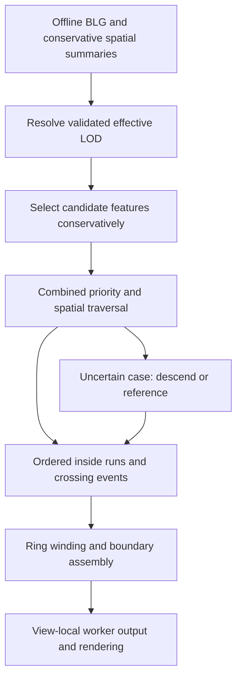

# Fused spherical BLG clipping

Proposed research design, 2026-11-26. Companion to [interactive performance roadmap](INTERACTIVE_ALGORITHMIC_PERFORMANCE.md). IP4b prototypes the algorithm independently; IP10 integrates it only after correctness and performance gates.
An initial isolated single-ring prototype is now provided in `examples/globe/blg-clip-prototype.mjs`. It builds conservative convex caps from subtree Cartesian bounds, preserves selected span endpoints (including fractional LOD and reversed traversal), and feeds compacted geometry to the existing clip assembler. No-crossing and collapsed cases fall back to full winding/reference selection. The renderer also streams ring classifications and supplies its actual land geometry to the minimap. This is not production BLG integration: multi-arc shared topology, winding certificates, actual atlas benchmarks and the IP10 gates remain open. Run `npm run build && node scripts/bench-blg-clip-node.mjs` for synthetic parity and p50/p95 measurements; no measured gain is claimed here.

## 1. Current path and proposed invariant

The current spherical core (src/spherical-dataset.ts) selects arc positions using BLG, reconstructs all features, validates them and promotes shared arcs in bounded repair passes. The globe receives the resulting geometry, culls features/rings, clips to a padded view cone (examples/globe/clip.mjs), then renders. Clipping currently scans ring vertices and pairs crossing pieces; a padded-window cache reduces repeated work on nearby camera poses.

Proposal: fuse spatial classification and level-of-detail pruning in ordered BLG traversal. Produce the same view-clipped polygon as reconstruct-then-clip, without materializing offscreen selected vertices. Never clip source geometry first and simplify camera-dependent output. The view must not affect selected vertex priorities, shared-arc promotion, feature validity or topology. Clipping creates render-only boundary vertices, never new topology IDs.

## 2. Spatial augmentation

BLG is an ordered min-Cartesian tree: each subtree represents a contiguous interval of the original arc. Add a conservative spherical cap or Cartesian 3D bound to each subtree, plus interval/endpoint metadata. Build bottom-up with constant work per node, O(M) time and storage for M stored arc positions, conditional on a constant-time conservative merge. Start with simple conservative cap union; compare 3D box, cap and hybrid layouts empirically. Use typed arrays or optional sidecar storage; avoid object overhead and do not change priority ordering in this prototype.

Bounding vertices is not sufficient by itself: LOD introduces great-circle shortcuts between nonconsecutive vertices. A cap strictly smaller than a hemisphere is geodesically convex and contains the minor arc connecting any two contained selected vertices. A conservative enclosing cap satisfying this condition therefore bounds all internal candidate shortcut edges. Larger/ambiguous caps, nearly antipodal endpoints, nonfinite arithmetic or insufficient numerical margin must be marked unprunable. A 3D box alone is not geodesically convex; an alternative must explicitly bound spherical arcs or derive a safe convex cap. Use outward numerical margins, never false-negative rejection. Prove bounds for forward and reversed arc references.

For view cone center u, angular radius r and subtree cap center v, radius s, let d = angular separation. Strictly disjoint when d > r+s with conservative margin; contained when d+s < r with margin; otherwise uncertain/intersecting. Handle wrap, tangencies and floating-point uncertainty by descending. Precompute fixed unit vectors. Prefer dot-product comparisons when mathematically equivalent; clamp and retain the conservative reference for degeneracy.

## 3. Traversal and ordered streaming

At fixed effective LOD (possibly different per shared arc):

1. Priority-prune subtrees exactly as ordinary BLG selection does. Endpoint and critical-vertex semantics remain unchanged. With IP3, order by full fractional threshold key; before it, use current traversal membership.
2. Classify a subtree against the padded cone. Fully inside: stream selected vertices in inorder with no per-vertex clipping checks (internal minor edges stay inside a convex view cone). Fully outside: skip interior traversal only if the cap certifies no internal selected edge can cross the cone. Intersecting/uncertain: descend and process selected node and children in order.
3. Outside subtrees emit a compact ordered span summary, not geometry: first and last selected vertices, whether empty, and winding information or a requirement to fall back. Find extremal selected positions by threshold-pruned inorder walks; count their cost, cache per effective state if justified. Do not claim constant-time summaries unless implemented. Preserve preceding/following selected endpoints across subtree and arc boundaries, including reverse references and ring closure.
4. Test the real joining minor arc between neighboring selected spans, even if both endpoints are outside; it can cross the cone twice. Do not connect visible runs by a synthetic chord across a skipped region. The summary is a proof of omitted internal edges, not a replacement polyline.
5. Emit ordered entry/exit events using the existing canonical edge orientation and intersection formulas so opposite shared references give bit-identical boundary positions. Assemble rings using IP4's event pairing, preserving holes, components, winding and boundary samples.

Possible representation: Empty | InsideRun | OutsideSpan(first,last,windingStatus) | BoundaryEvents. Keep it internal; avoid public API commitments before prototype results. Traverse iteratively; account for potentially linear BLG height. Stream per arc/ring or cache by arc, effective state and exact padded window; reversed iteration must not mutate shared cached sequences.

## 4. Enclosure and numerical correctness

An exterior ring can enclose the entire view cone without a visible vertex or boundary crossing. A hole can likewise cover the entire view. No-crossing does not imply invisible. The existing winding-around-center predicate distinguishes these cases; preserve it as the oracle. For a skipped span, prove that its winding contribution can be replaced by that of its endpoint chord only if the original selected path and chord are homotopic inside a convex region avoiding the view center and its antipode (the azimuth projection singularities). Accumulate contributions consistently with the reference branch conventions; if this cannot be certified, descend or fall back to full winding evaluation. Never infer enclosure from bounds alone. Also preserve source ring order and detect nonfinite, tangent, zero-length and near-antipodal cases conservatively.

Tests must distinguish an outside ring, a wrapping shell, a wrapping hole, an outside-to-outside crossing, tangency, a fully contained ring and multiple disconnected clipped pieces. Test dateline/poles, repeated endpoints, reversed shared arcs, nested holes, tiny or collapsed rings, long thin features, boundary epsilon ties, near-antipodal edges and deep/degenerate BLG trees. Compare to current reconstruct-then-clip plus an independent geometric oracle where feasible. Shared crossings should be bit-identical; documented numeric tolerance may be used for independently computed geometry, never to conceal topology or winding differences. The reference itself is not a proof of arbitrary spherical polygon correctness; explicitly investigate discrepancies.

## 5. Interaction with validation and repair

The first prototype operates on already validated immutable geometry at known effective detail states, with camera-independent arc promotions. Do not validate only the visible clipped fragment: offscreen invalidity may promote an arc used by visible neighbors. Do not disable current validation to manufacture a speedup.

Three integration levels, in increasing ambition:

- Renderer-only: retain global validation/reconstruction; accelerate repeated clipping of validated frames with a spatial hierarchy. Useful baseline but does not reduce global worker output.
- Fused traversal on certified effective states: offline certificate or current globally resolved state identifies selected arc levels. Worker directly traverses/culls/clips, avoiding full frame materialization and transfer on eligible queries. Unknown states use reference path.
- Viewport-local retrieval: IP9 conservative feature bounds, certified repair states and dependency closure avoid global traversal entirely. Only pursue when completeness and shared boundaries can be proven.

Keep current global query API; proposed view-aware internal interface accepts immutable dataset/state identity, padded view cone and cancellation token. Include explicit fallback and completeness diagnostics. Camera rotation may reuse padded-window result; zoom changes effective state and invalidates it. Cache key includes dataset/priority/validator version, effective arc state and window. Bound memory; preserve stale-generation suppression and cooperative cancellation (yield inside large traversals/event assembly if feasible). Minimap retains separate coarse global context.

## 6. Complexity and acceptance

Let M be full stored arc positions, K global selected vertices, W visited BLG nodes including extremal-summary work, R processed arc references, E tested joining/crossing edges, c clipping pieces, z generated boundary samples, Kvis visible emitted positions, U uncertain winding/reference work. Offline augmentation O(M) time/space under constant-time conservative merges. Candidate selection cost is separate. Target view traversal/assembly O(W + R + E + c log(c+1) + z + Kvis + U) after IP4, plus output and feature/repair resolution. W may be proportional to visible/boundary complexity in favorable cases, but can equal M in degenerate or overlapping bounds, fractional rejection or ambiguous winding. No universal logarithmic or output-only guarantee. Global validation and full frame construction remain if not eliminated by IP7/IP9. Memory includes O(M) summaries, traversal stack (potentially O(M)), output and bounded caches. Compare against existing padded-window cache, not just an uncached baseline.

## 7. Implementation sequence and go/no-go

**IP4b-A (prototype, after IP0):** isolated cap union/classifier with proof notes and randomized containment tests over all selected shortcut edges on small fixtures; verify unprunable cases. Compare memory and tightness. No production tree edits.

**IP4b-B (after A, same isolated research track):** threshold-and-spatial ordered traversal, span endpoint summaries, shared/reversed arc boundary crossings, winding fallback and reference clip assembly. Tests compare exact selected membership and clipped output across fixed valid states and seeded camera/zoom sweeps. Include counters for visited/skipped nodes, candidate edges, winding fallbacks, allocations and generated vertices. Do not require IP3 production changes for this prototype.

**IP4b-C (after B):** compare full reconstruct-then-clip, cached renderer-side clipping and fused prototype; high zoom, full globe, rotation within/outside padding, varying feature sizes and holes; report p50/p95 latency, memory, output bytes and operation counts. No timing-only CI gate. Advance only if correctness parity holds and meaningful operation-count reduction is demonstrated on representative high-zoom workloads without unacceptable regressions elsewhere.

**IP10-A (after IP4, IP4b, IP9 and inherited IP3/IP7 gates):** integrate optional internal worker path on certified states; retain reference fallback. Validate both paths, shared arc identity, generation cancellation, memory budget and cross-browser behavior.

**IP10-B (after A):** evaluate conservative viewport-local retrieval and view-local worker payload, keep minimap independent. Enable by default only with documented parity and measured gains; otherwise retain experimental/renderer-only mode. Publish results and actual complexity in IP11.

IP4b-A/B/C are sequential slices within one research track; split into separate direct-to-main PRs if the prototype is large. They can proceed concurrently with IP1/IP2/IP3/IP4 once baseline lands. IP10 is explicitly downstream of correctness gates; no requirement to ship an unsuccessful optimization.

## 8. References in the repository

- src/blg.ts — ordered threshold traversal
- src/reconstruct.ts — arc/path reconstruction
- src/spherical-dataset.ts — global validity and shared-arc promotion
- src/spherical-geometry.ts — spherical predicates
- examples/globe/clip.mjs and cull.mjs — clipping and feature caps
- docs/GLOBE.md — current renderer ordering
- README.md — analytical complexity baseline
