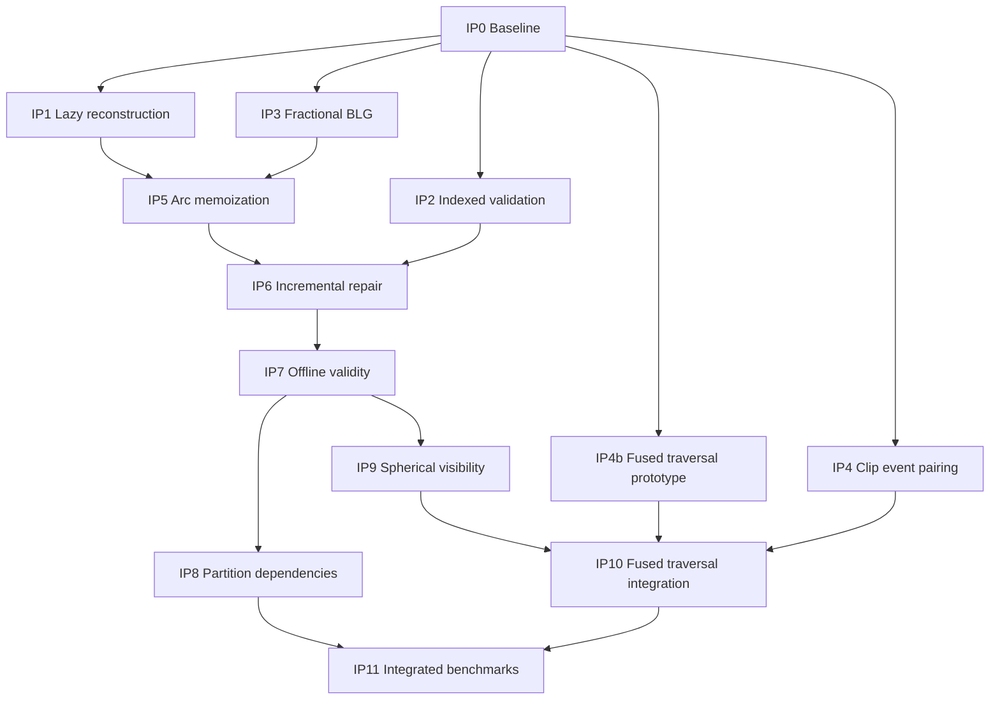

# Interactive algorithmic performance roadmap

Proposed 2026-11-26 after README PR #10. Refines the performance work in [PROJECT_ROADMAP.md](PROJECT_ROADMAP.md). All implementation PRs target current main directly; no stacked PRs. Preserve the public API, deterministic shared boundaries and zero runtime dependencies unless separately approved.

## Objective and baseline

Make interactive work scale with visible simplified geometry, not original geometry. Separate offline build, client startup, cold/warm query, validation, transfer, clipping and drawing. The planar packed feature-bounds index is not a segment index. Spherical queries currently simplify and repair globally before the globe renderer culls and clips the received frame. The padded-window cache already amortizes some clipping work.

Notation: T = full positions across selected arc references, K = emitted coordinates, R = selected arc references, H = arc-feature incidences, M = stored arc positions, P = partitions, c = clipping pieces, C = overlapping segment-box candidate pairs, z = generated boundary samples. Bounds are analytical, not measured gains.

## PR DAG and execution waves

| Wave | Standalone PRs | Priority and gates |
| --- | --- | --- |
| 0 | IP0 | P0 benchmark and oracle |
| 1 | IP1, IP2, IP3, IP4, IP4b | P0 IP1/IP2; P1 IP3/IP4b; P2 IP4; parallel in distinct files |
| 2 | IP5 | P1 after IP1/IP3 |
| 3 | IP6 | P1 after IP2/IP5 |
| 4 | IP7 | P1 design gate after IP6 |
| 5 | IP8, IP9 | P2 parallel after validity gate |
| 6 | IP10 | P1 research integration after IP4/IP4b/IP9 |
| 7 | IP11 | P1 final validation |

Edges are conservative merge gates, not prohibitions on earlier design research. IP1 owns reconstruct.ts; IP2 owns geometry.ts and index internals; remove duplicate reconstruction validation only after IP1 merges. IP4b uses isolated experimental code and does not modify production BLG. IP4 can proceed independently after IP0. Rebase on current main and rerun parity checks. If a research gate fails, record no-go, retain reference behavior, and revise downstream dependencies. IP10 may still accelerate the renderer on already validated effective detail states even if viewport-local retrieval is not feasible.

## Individual PR scope

- **IP0:** instrument original-ID scans, visited/emitted BLG nodes, unique arc traversals, candidate/exact segment predicates, global/per-feature validation, repair passes, partition bytes/requests, worker transfer, clipping and drawing. Record cold/warm p50/p95, peak memory, output size, device/runtime, seeds and repeats. Use real atlas, historical fixtures where available, synthetic 10k/100k/1M vertices, dense overlap, holes, shared/reversed arcs, dateline/poles and clustered partitions. Retain reference algorithms. Deterministic work counts and semantic parity are CI gates; timings are reported, not flaky thresholds.
- **IP1:** lazily collect original arc IDs only for collapsed-ring restoration. Avoid reversed full-array copies; preserve missing-coordinate and closure semantics. Ordinary integer reconstruction before validation becomes O(R+K) rather than O(T+R+K); fallback remains O(T).
- **IP2:** add inclusive segment AABB rejection before orientation, then use the existing packed spatial index for large ring and shell/hole candidate pairs, testing each pair once. Preserve adjacency exclusions, touching, collinear and containment semantics; retain small-input quadratic oracle. Reuse projected spherical charts where valid; remove redundant simple-ring pass after IP1. Build O(K log K), candidate work depends on overlap and visited nodes; worst case remains quadratic (or worse with repeated result sorting). Compare RBush/Flatbush as optional dev benchmarks, not runtime dependencies.
- **IP3:** order Cartesian heap by level then decreasing stable random value so fractional threshold traversal can prune rejected subtrees. Preserve exact membership, critical vertices, endpoints, ties and inorder. O(M) build; target O(K+1) traversal for fractional and integer levels; no balanced-height promise.
- **IP4:** replace exhaustive exit-to-entry azimuth pairing in globe clipper with sorted events and directional successor lookup: O(c log c) rather than O(c²). Preserve tie, wrap, epsilon, winding and deterministic order.
- **IP4b:** isolated fused traversal feasibility prototype, specified in the companion design.
- **IP5:** memoize canonical selected positions by arc and effective detail state; iterate reverse references without mutating cache. Scope to query or bounded cache; invalidate appropriately for partial sessions. Unique arc selection plus unavoidable output copies.
- **IP6:** build O(H) reverse arc-to-feature incidence, track invalid features and touched arcs, preserve simultaneous per-pass promotions and repair cap. Reconstruct only affected features. Preserve synchronous and interruptible parity; initial validation remains global.
- **IP7:** design offline validity/repair certificates for immutable inputs, initially integer levels. Fractional states have finite priority events but potentially O(M) distinct states; naive full-frame storage may be quadratic. Evaluate quantized or incremental certificates, never assume monotonic validity. Version certificates by dataset, priority algorithm and validator; preserve fallback/repair semantics and reference behavior for unknown states.
- **IP8:** derive partition dependencies from visible feature/arc selections and fallback, not record bounds alone. Include offscreen endpoints, crossing segments, and enclosing shells/holes. Preserve global completeness contract; add explicit viewport completeness if needed. Test partial loads, cancellation and stale arrivals. No spherical protocol implied.
- **IP9:** conservative spherical feature/component bounds and optional hierarchy. Include geodesic edges and interiors, not just vertices. Prune only after effective globally consistent LOD/repair state is known. Keep global query API. No logarithmic worst-case guarantee.
- **IP10:** integrate the fused traversal only after the prototype, clipping assembler and visibility/validity gates. See companion design.
- **IP11:** integrated benchmarks and README complexity reconciliation. Measure operation counts, cold/warm latency, memory, bytes, clipping and rendering; publish negative results and residual limitations.

## Dedicated design

See [Fused spherical BLG clipping](FUSED_SPHERICAL_BLG_CLIPPING.md) for the detailed algorithm, correctness proof obligations, implementation slices, and go/no-go gates. This is a proposed optimization, not implemented or empirically validated.
